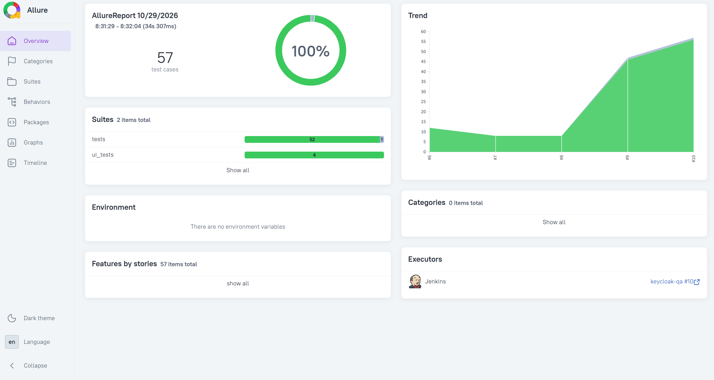
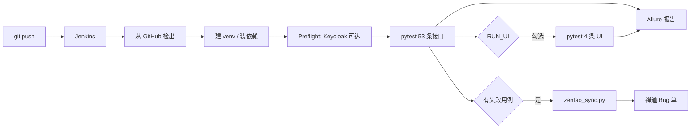
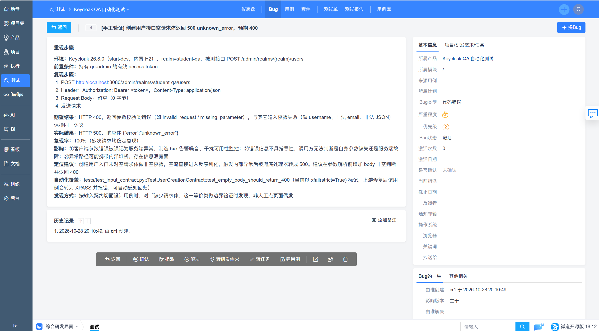

# Keycloak 自动化测试与安全验证

对 Keycloak 26.8.0 的 Admin REST API 做接口自动化与安全基线验证，共 **57 条用例**，覆盖认证越权、多租户隔离、权限矩阵、输入契约、并发幂等、状态与令牌生命周期六个切面。

流水线由 Jenkins 驱动：GitHub 检出 → pytest → Allure 报告归档 → 失败用例自动提交禅道 Bug。



---

## 为什么测 Keycloak

身份认证是所有系统的入口。业务代码的 Bug 通常影响一个功能，认证层的 Bug 会影响所有功能——越权访问、令牌伪造、跨租户数据泄露都属于这一类。而且 Keycloak 是成熟产品，适合用来练「怎么在没有明显 Bug 的系统上，把安全边界一条条钉死」。

被测对象用 `docker compose` 起本地实例（`start-dev` + 内置 H2），不依赖外部中间件。

---

## 用例规模

| 测试文件 | 条数 | 关注点 |
|---|---:|---|
| `tests/test_security.py` | 5 | 无 token / 伪造 token / 篡改 JWT / 普通用户越权 / 跨 realm 访问 |
| `tests/test_user_lifecycle.py` | 3 | 用户 CRUD 全链路、列表可见性、重名冲突 |
| `tests/test_multitenant.py` | 11 | 租户开户/销户、租户管理员权限边界、跨租户数据隔离 |
| `tests/test_session.py` | 4 | refresh 续期、logout 撤销、错误密码、禁用用户登录 |
| `tests/test_rbac.py` | 5 | composite 角色继承、权限即时撤销、realm/client 角色归属、改密后旧 token |
| `tests/test_input_contract.py` | 12 | 缺失/非法/超长字段、非法 JSON、错误 Content-Type、长度边界 2/3/255/256 |
| `tests/test_concurrent.py` | 3 | 并发建同名用户、重复删除幂等、并发 refresh |
| `tests/test_state_time.py` | 10 | 禁用/启用来回、临时密码、多会话、access token 过期、notBefore 撤销 |
| `ui_tests/test_admin_ui.py` | 4 | Playwright 驱动管理后台：登录、建用户、分配角色、建 realm |
| **合计** | **57** | 53 条接口 + 4 条 UI |

---

## 用例是怎么想出来的：六个切面

写用例的瓶颈不在于写，而在于「想不出还能测什么」。这个项目按固定切面去扫，每个切面配一个问题模板：

| 切面 | 问自己 | 落地到哪里 |
|---|---|---|
| 功能与异常 | 成功做什么？失败有哪几种？ | `test_security` / `test_user_lifecycle` |
| 输入契约 | 每个字段收到脏数据会怎样？ | `test_input_contract` |
| 状态与时间 | 状态怎么迁移？时间到了会怎样？ | `test_state_time` / `test_session` |
| 权限矩阵 | 谁 × 对什么 × 做什么？ | `test_rbac` / `test_multitenant` |
| 并发与幂等 | 两个请求同时到？同一请求发两次？ | `test_concurrent` |
| 配置与兼容 | 换 client / scope / grant type 会怎样？ | 未单独成组，散落在 session 与 rbac 里 |

筛选原则只有一条：**这条用例失败时，能说明系统有什么缺陷吗？** 答不上来的不写。

---

## 项目结构

```
Keycloak-QA/
├── keycloak_client/           封装层：把 HTTP 细节收在这，用例里只写业务语义
│   ├── client.py              KeycloakClient：用户 CRUD、角色、会话、token 校验
│   ├── platform.py            PlatformAdmin：realm 级开户/停用/销户（需 master 权限）
│   └── __init__.py
├── conftest.py                fixture：会话级客户端、唯一用户名、多租户、临时 realm
├── tests/                     53 条接口用例
├── ui_tests/                  4 条 Playwright 用例（Page Object 模式，pages.py）
├── ci/
│   ├── zentao_sync.py         解析 JUnit XML → 禅道建单（含去重、dry-run）
│   └── samples/               联调用样例 XML
├── perf/keycloak_token.jmx    JMeter 压测脚本
├── Jenkinsfile                7 个 stage 的声明式流水线
├── docker-compose.yml         被测环境
└── docs/
    ├── Keycloak测试执行方案.docx   P0–P7 执行路线
    └── images/                截图
```

分层的意义：`conftest.py` 提供环境与数据，`keycloak_client/` 屏蔽协议细节，`tests/` 只描述「期望什么行为」。换个 realm 或换套断言，不用动封装。

---

## 几个值得说的测试设计

### 1. 用 realm 建模租户

多租户没有写业务代码，直接拿 Keycloak 的 realm 当「一家公司」。先实测确认了权限模型天然吻合：

| 账号 | 创建新 realm | 管理 `student-qa` |
|---|---|---|
| `master` 管理员 | **201 可以** | 200 |
| `student-qa` 的 `qa-admin` | **403 拒绝** | 200 |

这就是平台方与租户管理员的边界。基于它写了 11 条：开户/重名冲突/销户/停用后不能登录、租户管理员只能管自己、同名用户在两个租户各存一份且 id 不同、A 的用户 token 打 B 被拒、删 A 的用户不影响 B。

### 2. 单独留对照组

「调别的租户被拒 403」这条，如果只有 403 这一半，无法排除「这个账号本来就没权限」。所以配了一条 `test_tenant_admin_can_manage_own_tenant`（200）做对照——有 200 才好说 403 是**越界被拦**，而不是**本来就无权**。

### 3. token 有效性用状态码判断

```
403 → 认出这个身份，但没有权限 → token 有效
401 → 没认出身份 → token 无效 / 已过期 / 用户被禁用 / 会话被撤销
```

这比调 `introspect` 端点更可靠。`introspect` 对公开客户端（本项目用的 `admin-cli`）恒返回 `403 Client not allowed.`，如果封装里把它静默处理成「无效」，所有断言都会假阴性——这个坑踩过一次，见「已知限制」。

### 4. xfail 用来记录缺陷，而不是跳过

发现的那个缺陷写成：

```python
@pytest.mark.xfail(strict=True, reason="已上报：空 body 返回 500 unknown_error，期望 400")
def test_empty_body_should_return_400(self, kc):
    assert kc.create_user_raw(raw_body="").status_code == 400
```

`strict=True` 的作用是：上游哪天修好了，这条测试会变成 **XPASS 并让构建失败**，强迫你回来删掉 `xfail`、确认缺陷真的修了。缺陷修复是可感知的，不会悄悄变绿。

### 5. 时间窗口跑在一次性 realm 上

`accessTokenLifespan` 是 realm 级全局配置，改小会让同一 realm 所有 token 提前过期，把其它 50 多条用例弄成随机失败。所以过期类用例每次新建一个随机名字的临时 realm（寿命压到 3 秒），用完在 `finally` 里删掉。

---

## CI 闭环



`Jenkinsfile` 有 7 个 stage：Checkout → Python 环境 → Preflight → 接口用例 → UI 用例 → 压测 → 同步禅道。

三个设计细节：

- **接口/UI stage 用 `catchError` 包住**。原本 pytest 一失败整个流水线就停在那，而「有失败用例」恰恰是最需要同步禅道的时候，所以把失败降级为 UNSTABLE，让后续 stage 继续跑。
- **禅道凭据走 Jenkins Credentials**。`.env` 已被 `.gitignore` 排除，Jenkins 从 GitHub 检出的是干净仓库，读不到本地配置，账号密码必须由 Jenkins 注入（凭据 ID：`zentao-login`）。
- **建单前按标题去重**。同一用例连续失败不会每天堆一条新 Bug；已解决/已关闭的仍会新建（说明回归了）。



---

## 本地运行

### 1. 起被测环境

```bash
docker compose up -d
# 管理后台 http://localhost:8080 （admin / admin）
```

首次运行后需要在 `student-qa` realm 里手工创建 `qa-admin` / `qa-admin-123`（P1 步骤，见 `docs/Keycloak测试执行方案.docx`）。

### 2. 装依赖

```bash
python -m venv .venv
# Windows
.venv\Scripts\activate
# macOS / Linux
source .venv/bin/activate

pip install -r requirements.txt
playwright install chromium
```

### 3. 跑

```bash
pytest tests          # 53 条接口，约 28 秒
pytest ui_tests       # 4 条 UI，约 20 秒
pytest tests ui_tests --alluredir=allure-results
allure serve allure-results
```

默认连 `http://localhost:8080` 的 `student-qa`。要换环境用环境变量覆盖：

```bash
export KC_BASE_URL=http://your-keycloak:8080
export KC_REALM=student-qa
export KC_ADMIN_USER=qa-admin
export KC_ADMIN_PASSWORD=你的密码
export KC_MASTER_USER=admin          # 时间窗口/多租户用例要用
export KC_MASTER_PASSWORD=你的密码
```

### 4. 跑 Jenkins 流水线

1. 新建 Pipeline 任务，SCM 指向本仓库，脚本路径 `Jenkinsfile`
2. 建凭据：Kind 选 **Username with password**，ID 填 **`zentao-login`**（禅道账号密码）
3. `Build with Parameters`，四个参数：

| 参数 | 作用 |
|---|---|
| `RUN_UI` | 是否跑 4 条 Playwright 用例 |
| `RUN_PERF` | 是否跑 JMeter 压测（10 线程 × 5 循环） |
| `SYNC_ZENTAO` | 是否把失败用例提交到禅道 |
| `JUNIT_FILE` | 要同步的 JUnit 文件，联调可填 `ci/samples/junit-failed-sample.xml` |

> 参数列表是「上一次成功解析 Jenkinsfile 时注册」的快照。改了 `parameters` 块之后，必须再成功跑一次构建，页面才会出现新参数。

---

## 发现的问题

| # | 问题 | 期望 | 实际 | 状态 |
|---|---|---|---|---|
| 1 | 创建用户接口收到空请求体 | 400 + 参数校验错误 | **500 `unknown_error`** | 已上报，`xfail(strict=True)` 守护 |

空 body 属于客户端参数错误，服务端没做兜底直接抛了 500。影响有三层：客户端错误被记成服务端异常、污染 5xx 告警；错误信息不具指导性，调用方分不清是自己的问题还是服务挂了；异常路径可能带出内部堆栈。详细复现步骤、影响与定位建议见禅道单（上图）。

---

## 已知限制

诚实列出来，比藏起来有用：

1. **被测产品的 token claims 不完整。** `student-qa` 这个 realm 的 access token 只有 8 个基础 claim，连 `sub` 和 `preferred_username` 都没有，`realm_access` / `resource_access` 也是空——是该 realm 的 user profile 被手工调整过导致的配置漂移。所以 RBAC 用例没有解析 JWT，改用 `role-mappings` 接口 + 实际请求权限验证，结论不依赖 realm 配置。
2. **`introspect` 端点用不了。** `admin-cli` 是公开客户端，调 `/token/introspect` 恒返回 403 `Client not allowed.`。封装里已改成显式抛错（原来静默返回 `{"active": false}`，会把「没权限」伪装成「已失效」），统一改用 `token_is_valid()`。
3. **压测没有正式数据。** 只有 JMX 脚本，`perf/report` 不进仓库。`start-dev` + 内置 H2 + 与 Jenkins 同机争 CPU，跑出来的吞吐只够做冒烟参考，不能当性能结论。要出正式数据应换 `start` 模式 + PostgreSQL + 独立压测机。
4. **禅道同步只扫接口结果。** `SYNC_ZENTAO` 读 `junit-api.xml`，UI 用例写在 `junit-ui.xml`，UI 失败不会自动建单。
5. **没有 webhook 自动触发。** 本地 Jenkins 没有公网地址，目前靠手动 `Build with Parameters`。
6. **时间窗口用例依赖 master 权限。** 建临时 realm 需要 `admin`，只配 `qa-admin` 时这 3 条会失败。

---

## 技术栈

| 组件 | 版本 | 用途 |
|---|---|---|
| Keycloak | 26.8.0 | 被测对象（`start-dev` + H2） |
| Python | 3.13 | 运行环境（3.11+ 均可） |
| pytest | 8.4.2 | 测试框架 |
| requests | 2.31+ | 接口调用 |
| Playwright + pytest-playwright | 1.48+ / 0.10 | UI 自动化 |
| allure-pytest | 2.16 | 报告 |
| Jenkins | 2.541.2 | 流水线 |
| JMeter | 5.6.3 | 压测 |
| 禅道 | 18.12 | 缺陷管理 |
